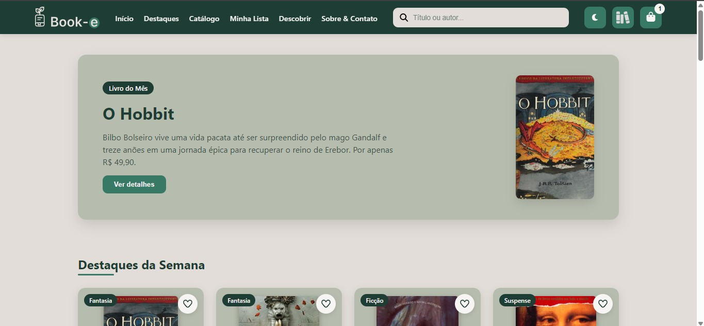
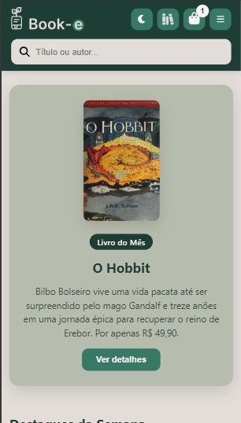
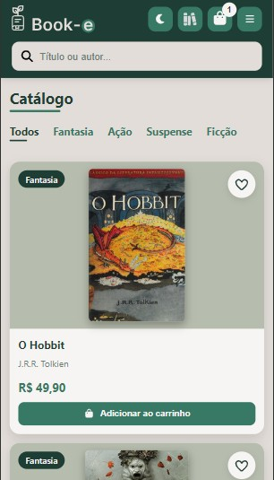

# 📚 Book-e — Livraria Online

Projeto desenvolvido como atividade final para consolidar conhecimentos de desenvolvimento web, utilizando HTML, CSS e JavaScript.

A **Book-e** é uma livraria virtual que permite explorar livros, pesquisar títulos, adicionar produtos ao carrinho e organizar uma lista de favoritos, proporcionando uma experiência de navegação simples e intuitiva.

## 👥 Integrantes

- **Matheus Henrique Luiz Venceslau**
- **Matheus Mendes Feitosa**

## 🛠️ Tecnologias utilizadas

| Tecnologia | Finalidade |
|---|---|
| HTML5 | Estruturação e organização do conteúdo da aplicação. |
| CSS3 | Estilização das páginas, responsividade e implementação dos temas claro e escuro. |
| JavaScript | Implementação das funcionalidades, manipulação do DOM e interatividade. |
| LocalStorage | Persistência de informações no navegador, como carrinho, favoritos e preferência de tema. |
| Fetch API | Realização de requisições HTTP para consumo de APIs externas. |
| Google Books API | Consulta de livros, informações, autores, capas e descrições. |
| ViaCEP API | Consulta automática de endereços a partir do CEP informado pelo usuário. |
| Font Awesome | Utilização de ícones para melhorar a navegação e a apresentação visual. |

## ✨ Funcionalidades implementadas

### Funcionalidades principais

- **Catálogo de livros:** exibição dos livros disponíveis na livraria.
- **Pesquisa de livros:** busca de títulos no catálogo.
- **Detalhes dos livros:** visualização de informações como título, autor, preço e descrição.
- **Carrinho de compras:** adição, remoção e gerenciamento de produtos.
- **Cálculo do total:** atualização do valor conforme os produtos adicionados ao carrinho.
- **Responsividade:** adaptação da interface para diferentes tamanhos de tela.

### Funcionalidades extras

- **Tema claro e escuro:** alternância entre os temas, com preferência salva no LocalStorage.
- **Lista de desejos:** possibilidade de favoritar livros e visualizar os itens em uma seção própria, semelhante a uma lista pessoal.
- **Integração com Google Books:** busca de livros por meio de uma API externa utilizando Fetch.
- **Descobrir livros:** seção dedicada à descoberta de novos títulos disponíveis na API.
- **Finalização de compra:** formulário para simular o preenchimento dos dados de entrega.
- **Consulta de CEP:** integração com a API ViaCEP para preenchimento automático dos dados de endereço.
- **Persistência de dados:** armazenamento local de informações para manter determinadas preferências e dados do usuário após atualizar a página.

> **Observação:** a finalização da compra é uma simulação acadêmica. O projeto não realiza pagamentos reais. As consultas à Google Books dependem da disponibilidade e dos limites de utilização da API.

## 🚀 Como executar o projeto localmente

### Pré-requisitos

- Navegador atualizado (Google Chrome, Firefox, Edge etc.).
- Visual Studio Code.
- Extensão **Live Server** instalada no Visual Studio Code.

### Passo a passo

1. Clone o repositório:

   ```bash
   git clone https://github.com/MatheusMFeitosa/Atividade-Final-Pagina-Web-de-Livraria.git
   ```

2. Acesse a pasta do projeto:

   ```bash
   cd Atividade-Final-Pagina-Web-de-Livraria
   ```

3. Abra o projeto no Visual Studio Code.

4. Localize o arquivo `html/index.html`.

5. Clique com o botão direito no arquivo e selecione **Open with Live Server**.

6. O projeto será aberto automaticamente no navegador.

**Importante:** utilize o Live Server para executar o projeto, pois algumas funcionalidades dependem de requisições HTTP para APIs externas.

## 🖥️ Capturas de tela

As imagens abaixo apresentam a interface da Book-e em diferentes dispositivos.

### Desktop

**Página inicial**



**Catálogo de livros**


### Dispositivos móveis

**Página inicial**



**Catálogo de livros**



## 📁 Organização do projeto

```text
Atividade-Final-Pagina-Web-de-Livraria/
│
├── css/
│   └── style.css
│
├── html/
│   └── index.html
│
├── media/
│   ├── ...
│
├── scripts/
│   ├── app.js
│   ├── livros.js
│   ├── carrinho.js
│   ├── favoritos.js
│   ├── descobrir.js
│   ├── api.js
│   ├── checkout.js
│   ├── menuMobile.js
│   ├── tema.js
│   └── validacaoContato.js
│
└── README.md
```

## 🎯 Objetivo do projeto

O objetivo da atividade é aplicar, na prática, os conhecimentos adquiridos durante o desenvolvimento web, trabalhando com estruturação de páginas, estilização, programação JavaScript, manipulação do DOM, armazenamento local, responsividade e integração com APIs externas.

---

**Desenvolvido por Matheus Henrique Luiz Venceslau e Matheus Mendes Feitosa.**